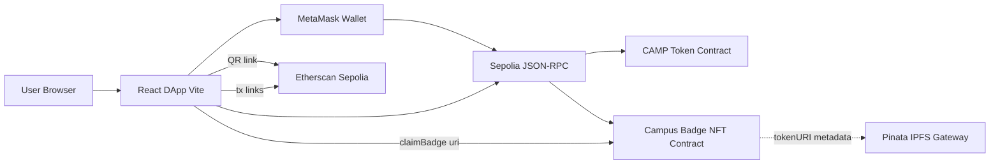
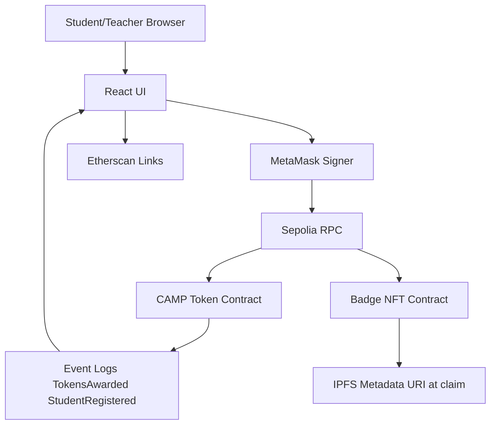
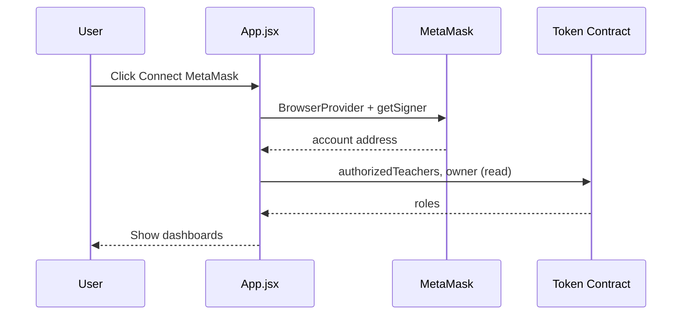
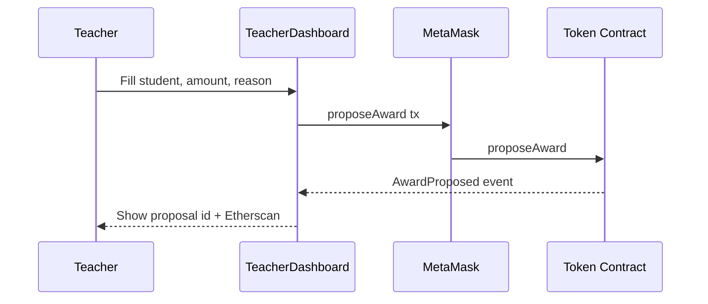
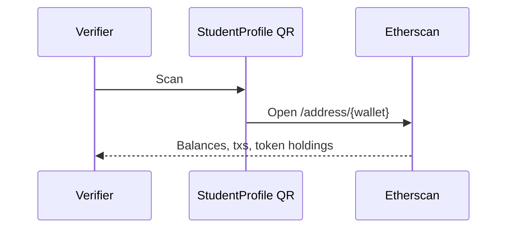
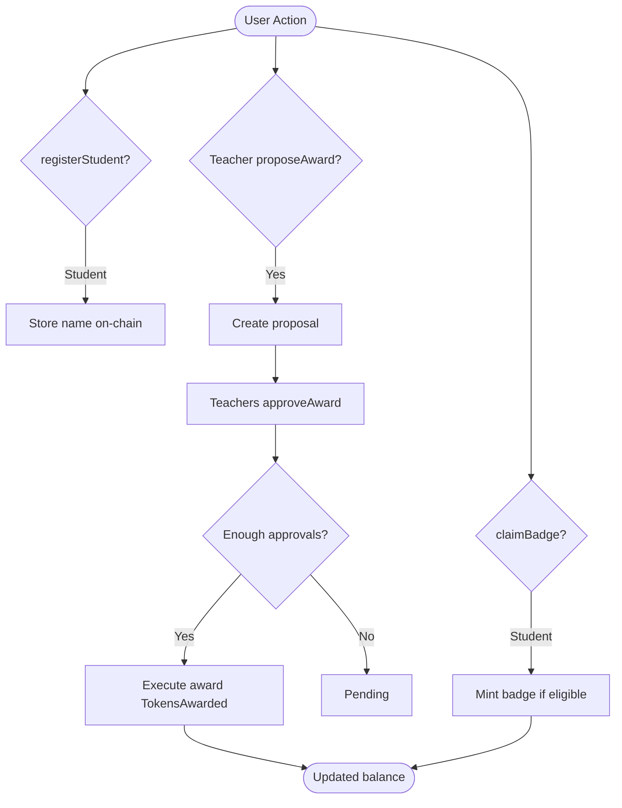

# Project Repository Analysis

**Analysis basis:** Actual source code and configuration files in the current Cursor workspace (`/Users/kakumanuharshithsubrahmanyam/Desktop/BlockChain_Project`), inspected on 22 October 2026.

**Accuracy rule:** Features not supported by repository evidence are not represented as completed features.

---

## Executive Summary — Intended Concept vs. Actual Implementation

| Aspect | Internship concept described by student | Actual repository implementation |
|--------|----------------------------------------|----------------------------------|
| Domain | Blockchain-based **academic certificate verification** (issuer stores **hash** of certificate; verifier checks tamper-evidence) | **Campus reputation / merit token** system (**CAMP** tokens + **NFT-style badges**) for students and teachers |
| Smart contract source | Typically Solidity in-repo | **No `.sol` files** in repository; only **ABIs and deployed addresses** in `config.js` |
| Certificate upload/hash | Expected | **Not implemented** — no PDF/image upload, no SHA-256/Keccak document hashing in frontend |
| Verification | Hash match against on-chain record | **Partial / indirect:** QR code links to **Sepolia Etherscan wallet address**; reputation read via **on-chain balance, level, badges, events** — not certificate hash comparison |
| Backend | May or may not exist | **No backend** — browser DApp talks directly to contracts via **ethers.js** |

**Authoritative rule:** Where documentation or internship brief differs from code, **this analysis follows the code**.

---

# PHASE 1 — COMPLETE REPOSITORY INSPECTION

## Scope of inspection

Recursively inspected (excluding `node_modules/`, `dist/` per instructions):

| Category | Finding |
|----------|---------|
| README | **Not found** in repository root |
| `package.json` / `package-lock.json` | Present |
| Frontend | React + Vite; components in project root and `src/components/` |
| Backend | **None** |
| Solidity / contracts | **`contracts/` directory exists but is empty**; zero `.sol` files anywhere |
| Hardhat / Truffle / Foundry | **Not found** |
| Deployment scripts | **Not found** |
| ABI files | **Embedded as string arrays** in `config.js` (`TOKEN_ABI`, `BADGE_ABI`) |
| Contract addresses | Hardcoded in `config.js` |
| `.env` / examples | **Not found** (no `.env.example`) |
| Tests | **No test files** (`*.test.js`, Hardhat tests, etc.) |
| IPFS | **Pinata gateway URLs** for badge metadata URIs passed to `claimBadge` — not general document storage |
| QR codes | `qrcode.react` in `StudentProfile.jsx` |
| Certificate generation/upload | **Not found** |
| Cryptographic document hashing | **Not found** in application code |
| Git metadata | Single initial commit: `bb4d402` — "Initial commit: Campus Reputation blockchain dApp frontend." |
| Vercel | `.vercel/project.json` — project name `block-chain-project` (deployment config only) |
| Screenshots/assets in repo | **Not found** (no `assets/`, `screenshots/`, sample PDFs) |
| `STUDENTS` seed array | Empty in `config.js` |

## What the project actually does (from code)

1. **Wallet-gated React DApp** (`App.jsx`) requiring MetaMask (`window.ethereum`).
2. Connects to two **already-deployed** contracts on **Ethereum Sepolia** (addresses in `config.js`).
3. **Students** register an on-chain name, view **CAMP token balance** and **reputation level**, claim **Bronze/Silver/Gold badges** (NFT contract) when balance thresholds are met.
4. **Authorized teachers** propose token awards; **multi-teacher approval** (UI shows **2 approvals** required) executes awards on-chain.
5. **Contract owner** can add teachers (owner-only UI section).
6. **Leaderboard** and **activity feed** aggregate on-chain events and balances.
7. **Profile QR** encodes an Etherscan URL for the wallet — labeled "On-Chain Verification" in UI, not document hash verification.

---

# PHASE 2 — PROJECT IDENTITY

## 1. Project Title

### Actual Project Name

Multiple names appear in the codebase:

| Source | Name |
|--------|------|
| `package.json` `"name"` | `campus-reputation` |
| `index.html` `<title>` | Campus Reputation Token |
| `ConnectWallet.jsx` branding | **Campus Reputation** |
| `Navbar.jsx` brand | **CampusToken** |
| GitHub repo (from prior session) | `campus-reputation` |

**Most consistent product name:** **Campus Reputation** (landing page + package name).

### Suggested Academic Project Title

**Primary (matches implementation):**  
**"Blockchain-Based Campus Reputation and Merit Token System Using Ethereum Smart Contracts"**

**Alternative (if report must emphasize verification theme without misrepresenting code):**  
**"A Web3 Decentralized Application for Transparent On-Chain Academic Reputation and Achievement Badges"**

**Not recommended unless scope is changed:**  
"Blockchain-Based Academic Certificate Verification System" — **does not match this repository**.

---

## 2. Project Overview

### What the project is

A **single-page decentralized application (DApp)** that lets university stakeholders interact with **two smart contracts** on **Sepolia testnet**: a **custom ERC-20-like merit token (CAMP)** with governance-style **teacher proposals/approvals**, and a **badge NFT contract** for milestone achievements. The UI provides dashboards for students, teachers, leaderboard ranking, live award activity, and a shareable profile with QR code.

### Real-world problem (as addressed by *this* code)

Traditional campus recognition (attendance points, participation credits, informal “reputation”) is often **opaque**, **centralized in spreadsheets**, and **hard to audit**. This project moves **merit accounting** and **achievement badges** to a **public ledger** so balances, award reasons, and badge ownership are **independently verifiable** via blockchain explorers and contract reads.

### Certificate fraud / manual verification (conceptual link)

While **certificate PDF verification is not implemented**, the same *class* of problem applies: employers and institutions need **trustworthy credentials**. Here, trust is shifted to **on-chain token balances**, **event logs** (`TokensAwarded`), and **NFT badge ownership** rather than to a forged paper certificate.

### Why traditional verification can be slow

Manual checks with registrars or email chains introduce delay. **This DApp** allows anyone with RPC access to **read** student balances, levels, and historical `TokensAwarded` events without a central API — *if* they know the student’s wallet address.

### How blockchain is used

- **State:** token balances, student names mapping, teacher authorization, award proposals, badge ownership.
- **Logic:** who may propose/approve awards, badge claiming rules (enforced in badge contract — exact rules **not visible without Solidity source**).
- **Events:** audit trail for awards, registrations, decay (decay **in ABI** but **not invoked from frontend**).

### On-chain vs off-chain data

| On-chain (via contracts — inferred from ABI + UI) | Off-chain |
|---------------------------------------------------|-----------|
| Wallet addresses, CAMP balances, reputation level string, student name string, proposal records, badge types owned, transaction history | Badge **metadata JSON/images** at Pinata IPFS URLs (URIs passed at claim time); UI styling; no certificate files |

### Who can “issue” (analogous to issuer)

- **Teachers** (`authorizedTeachers`) propose awards; execution after **peer approvals** (UI: 2 approvals).
- **Owner** adds teachers via `addTeacher`.
- Direct `awardTokens` exists in ABI but is **not called** from the frontend — **Not determinable from the repository** whether it is owner-only or unused in production.

### Who can verify

- **Any public user** can read Sepolia state via Etherscan or RPC (no login in DApp).
- **QR scanner** opens Etherscan **address** page — verifier must interpret blockchain data manually or via explorer UI.

### Student / holder role

Register name, earn tokens (via teacher workflow), view level, claim badges, share wallet/QR, appear on leaderboard if balance &gt; 0.

---

## 3. Problem Statement (Academic, ~400 words)

Academic and professional ecosystems depend on **credentials** that prove achievement, attendance, and conduct. When credentials are paper-based or stored in siloed databases, **forgery**, **alteration**, and **slow third-party verification** become systemic risks. Employers and higher-education offices often rely on **central authorities**—registrars, email confirmations, or manual document review—creating bottlenecks and inconsistent trust boundaries. **Document tampering** may go undetected if verifiers lack cryptographic tools to compare a presented file against an authoritative fingerprint. **Transparency** suffers when audit trails live in editable spreadsheets rather than append-only logs.

**Blockchain technology** offers **tamper-evident, replicated state**: once a transaction is confirmed, records of token transfers and emitted events become costly to rewrite across the network. Smart contracts can encode **authorization rules**—for example, which addresses may propose merit increases—reducing reliance on a single administrator’s database.

**In this specific internship repository**, the implemented response is **not** a certificate-hash registry. Instead, the system implements a **Campus Reputation** model: merit is represented as **CAMP tokens** on **Ethereum Sepolia**, with **multi-teacher approval** before awards execute (`proposeAward` / `approveAward` in `TeacherDashboard.jsx`). Students receive a **persistent wallet-linked identity** (`registerStudent`), a **machine-readable reputation tier** (`getReputationLevel`), and **NFT badges** tied to IPFS metadata URIs (`claimBadge` in `StudentDashboard.jsx`). Third parties can **verify** claims by inspecting **on-chain balances, badge ownership, and `TokensAwarded` events**—for example through links in `ActivityFeed.jsx` to `sepolia.etherscan.io`.

This approach addresses **integrity of merit records** and **auditability of who received tokens and why**, but it **does not** store or hash degree certificates, **does not** implement revocation of credentials, and **does not** bind legal identity to wallet addresses without off-chain processes. The problem statement for a formal report should therefore frame the work as **transparent, decentralized academic reputation management**, while treating **full certificate lifecycle verification** as **out of scope** of the current codebase unless extended in future work.

---

## 4. Objectives

### Primary Objective

Design and deliver a **Web3 frontend** that integrates with **deployed Ethereum smart contracts** to manage **on-chain campus reputation** (tokens, levels, badges) with **role-based teacher workflows** on **Sepolia testnet**.

### Specific Objectives

| Objective | Status in repository |
|-----------|----------------------|
| Connect browser wallet (MetaMask) to DApp | **Implemented** — `App.jsx`, `ConnectWallet.jsx` |
| Student self-registration on-chain | **Implemented** — `registerStudent` |
| Teacher-proposed token awards with approval workflow | **Implemented** — `TeacherDashboard.jsx` |
| Display reputation score, level, badges | **Implemented** — `StudentDashboard.jsx`, `StudentProfile.jsx` |
| Leaderboard from on-chain data | **Implemented** — `Leaderboard.jsx`, `campTokens.js` |
| Public activity / audit feed | **Implemented** — `ActivityFeed.jsx` |
| NFT badge claiming with IPFS URI | **Implemented** — `claimBadge` + Pinata URLs in `config.js` |
| Owner-managed teacher roster | **Implemented** — `addTeacher` when `isOwner` |
| Store cryptographic hash of certificate documents on-chain | **Not implemented** — **Conceptual / Future Enhancement** |
| Upload/issue PDF certificates | **Not implemented** — **Conceptual / Future Enhancement** |
| Automated hash-based certificate verification UI | **Not implemented** — **Conceptual / Future Enhancement** |
| Token decay enforcement UI | **Partial** — `applyDecay` in ABI only; **no frontend call** |
| Smart contract development in this repo | **Not present** — contracts external |
| Automated test suite | **Not present** |

---

# PHASE 3 — TECHNOLOGY STACK

| Layer | Technology | Version if detectable | Purpose in Project | Evidence/File |
|-------|------------|----------------------|-------------------|---------------|
| Language | JavaScript (ES modules) | — | Application logic | `"type": "module"` in `package.json` |
| Frontend framework | React | 18.3.1 (lockfile) | UI components | `package-lock.json`, `*.jsx` |
| Build tool | Vite | 5.4.21 (lockfile) | Dev server & production bundle | `vite.config.js`, `package.json` scripts |
| Vite plugin | @vitejs/plugin-react | 4.7.0 (lockfile) | JSX/React HMR | `package-lock.json` |
| Blockchain library | ethers.js | 6.16.0 (lockfile) | Contract instances, events, txs | `App.jsx`, all dashboards |
| Wallet | MetaMask (injected `window.ethereum`) | — | Sign transactions, provide account | `App.jsx`, `ConnectWallet.jsx` |
| Blockchain network | Ethereum Sepolia testnet | Chain ID **11155111** (UI text) | Target network for contracts | `StudentDashboard.jsx`, Etherscan URLs |
| Smart contracts | External deployed contracts | Addresses in `config.js` | Token + badge logic | `CAMPUS_TOKEN_ADDRESS`, `CAMPUS_BADGE_ADDRESS` |
| Solidity source | — | — | **Not in repository** | Empty `contracts/` |
| Hardhat / Truffle / Foundry | — | — | **Not used in repo** | Not found |
| IPFS / Pinata | HTTPS gateway URLs | — | Badge metadata URIs at claim | `config.js` `*_IPFS_URI` |
| QR codes | qrcode.react | 4.2.0 (lockfile) | Profile QR to Etherscan | `StudentProfile.jsx` |
| CSS | Custom CSS + CSS variables | — | Full UI theme | `index.css` (~1200 lines) |
| Tailwind CSS | tailwindcss | 3.x (package.json ^3.4.0) | **Listed in devDependencies but not applied in `index.css`** (no `@tailwind` directives); `tailwind.config.js` content paths omit root JSX | `package.json`, `tailwind.config.js`, `index.css` |
| PostCSS / Autoprefixer | — | ^10.4 / ^8.4 | **Not wired** (no `postcss.config.js`) | Not found |
| Backend / DB | — | — | **None** | — |
| Web3.js / wagmi / viem | — | — | **Not used** | — |
| SHA-256 / document hashing | — | — | **Not implemented** in app code | Grep: no cert hash logic |
| Deployment platform | Vercel (metadata only) | — | Hosting config artifact | `.vercel/project.json` |
| TypeScript | — | — | **Not used** (JSX only) | — |

---

# PHASE 4 — PROJECT ARCHITECTURE

## Architecture description

- **Client-only SPA:** React app served by Vite; no server-side API.
- **Wallet layer:** MetaMask injects Ethereum provider; ethers `BrowserProvider` + `Signer`.
- **Contract layer:** Two contracts bound by address + human-readable ABI fragments.
- **Indexing strategy:** Leaderboard/student list built by **scanning event logs** (`StudentRegistered`, `TokensAwarded`) — not a subgraph.
- **External services:** Sepolia RPC (via MetaMask), Sepolia Etherscan (links), Pinata IPFS gateway (badge URIs).



### Component explanations

1. **React UI** — Routes/tabs in `App.jsx`; no React Router (tab state only).
2. **MetaMask** — Account, signing, network; reload on account change.
3. **ethers.js** — `Contract` read/write, `queryFilter` for events.
4. **Token contract** — Balances, names, levels, proposals, teacher ACL.
5. **Badge contract** — `hasBadge`, `claimBadge`.
6. **IPFS URLs** — Static constants; metadata not fetched in UI for display.
7. **Etherscan** — Human verification of txs and addresses.

---

# PHASE 5 — FOLDER AND FILE STRUCTURE

```text
BlockChain_Project/
├── App.jsx                    # Root app: wallet, contracts, tabs
├── main.jsx                   # React entry
├── index.html                 # Page shell, title
├── index.css                  # Global styles
├── ConnectWallet.jsx          # Landing / connect MetaMask
├── Navbar.jsx                 # Tab navigation
├── StudentDashboard.jsx       # Student score, register, claim badges
├── TeacherDashboard.jsx       # Propose/approve awards, add teachers
├── Leaderboard.jsx            # Top 10 by balance
├── campTokens.js              # Event aggregation helpers
├── config.js                  # Addresses, ABIs, IPFS URIs
├── vite.config.js
├── tailwind.config.js         # Present; minimal use
├── package.json
├── package-lock.json
├── contracts/                 # Empty directory
├── src/
│   └── components/
│       ├── StudentProfile.jsx # Profile, QR, copy address
│       └── ActivityFeed.jsx   # Recent TokensAwarded feed
├── .gitignore
├── .vercel/                   # Vercel project metadata
└── dist/                      # Build output (generated, gitignored)
```

| Path | Purpose |
|------|---------|
| `App.jsx` | Orchestrates connection, contract instances, role flags, tab routing |
| `config.js` | Single source of chain addresses and ABI strings |
| `campTokens.js` | Derives leaderboard candidates from events + `balanceOf` |
| `StudentDashboard.jsx` | Primary student UX including badge claims |
| `TeacherDashboard.jsx` | Governance workflow for awards |
| `Leaderboard.jsx` | Rankings UI |
| `ActivityFeed.jsx` | Public award history from events |
| `StudentProfile.jsx` | Shareable identity + QR |
| `ConnectWallet.jsx` | Marketing copy + connect button |
| `index.css` | Design system (colors, cards, forms) |
| `contracts/` | Placeholder; no Solidity |

---

# PHASE 6 — SMART CONTRACT ANALYSIS

## Critical limitation

**No Solidity source files exist in this repository.** Analysis below is derived from **`config.js` ABIs**, **frontend call patterns**, and **inferred contract behavior**. Solidity version, modifiers, storage layout, and exact approval threshold logic are **Not determinable from the repository** except where the UI assumes **2 approvals** (`TeacherDashboard.jsx`).

---

## Contract 1 — Campus Token (inferred name)

### File Location

**Not in repository.** Deployed address: `0xF2c2bC22de5df5e95F5bB27b65E53b569E83d918` (`config.js`).

### Solidity Version

**Not determinable from the repository.**

### Purpose

Custom **ERC-20-like** campus merit token (**CAMP**) with **owner**, **authorized teachers**, **student registration**, **multi-step award proposals**, optional **decay** (ABI present), and **reputation level** query.

### State Variables (inferred from ABI — public getters)

| Variable / getter | Type (inferred) | Purpose |
|-------------------|-----------------|---------|
| `owner()` | address | Contract administrator |
| `authorizedTeachers(address)` | bool | Teacher role flag |
| `studentNames(address)` | string | On-chain display name |
| `lastActiveTime(address)` | uint256 | Activity tracking (decay-related — exact use **Not determinable**) |
| `decayInterval()` | uint256 | Decay timing parameter |
| `decayAmount()` | uint256 | Decay magnitude |
| `proposalCount()` | uint256 | Number of proposals |
| `proposals(id)` | struct | Award proposal record |
| `hasApproved(proposalId, address)` | bool | Per-teacher approval tracking |
| ERC-20 style | balances, allowances, etc. | Token transfers |

### Structs

**`proposals(uint256)` return tuple** (from ABI string):

| Field | Type | Purpose |
|-------|------|---------|
| id | uint256 | Proposal identifier |
| student | address | Recipient |
| amount | uint256 | Award size (frontend treats as integer CAMP in `rawAmount`) |
| reason | string | Human-readable reason |
| proposer | address | Teacher who proposed |
| approvalCount | uint256 | Approvals collected |
| executed | bool | Whether tokens were awarded |

### Mappings

| Mapping | Keys → Values | Purpose |
|---------|---------------|---------|
| `authorizedTeachers` | address → bool | Teacher ACL |
| `studentNames` | address → string | Name registry |
| `lastActiveTime` | address → uint256 | **Not determinable from the repository** |
| `hasApproved` | (proposalId, address) → bool | Approval tracking |

### Events

| Event | Parameters | When Emitted | Purpose |
|-------|------------|--------------|---------|
| `TokensAwarded` | student, amount, reason | After award execution | Audit / UI feed |
| `TokensDecayed` | student, amount | Decay applied | **Not used in frontend** |
| `TeacherAdded` | teacher | New teacher | **Not subscribed in frontend** |
| `StudentRegistered` | student, name | Registration | Leaderboard discovery |
| `AwardProposed` | proposalId, student, amount, reason, proposer | New proposal | Parse proposal id from receipt |
| `AwardApproved` | proposalId, approver, approvalCount | Approval step | **Not displayed in UI** |

### Modifiers

**Not determinable from the repository.**

### Constructor

**Not determinable from the repository.**

### Functions

| Function | Inputs | Visibility | Mutability | Purpose | Who Can Call |
|----------|--------|------------|------------|---------|--------------|
| `registerStudent` | name | **Not determinable** | write | Register student name | Used by any connected student in UI |
| `proposeAward` | student, amount, reason | **Not determinable** | write | Create award proposal | Teacher (expected) |
| `approveAward` | proposalId | **Not determinable** | write | Approve proposal | Teacher; UI blocks self-approve |
| `addTeacher` | teacher | **Not determinable** | write | Authorize teacher | Owner (UI gated) |
| `awardTokens` | student, amount, reason | **Not determinable** | write | Direct award | **Not called from frontend** |
| `applyDecay` | student | **Not determinable** | write | Reduce balance | **Not called from frontend** |
| `getReputationLevel` | student | public | view | Level string | Anyone |
| `balanceOf` | address | public | view | Token balance | Anyone |
| ERC-20 functions | various | public | view/write | Transfers | **Not used in UI** |

### Certificate-specific functions

**None** — no `issueCertificate`, `verifyHash`, or similar in ABI.

---

## Contract 2 — Campus Badge (inferred name)

### File Location

**Not in repository.** Address: `0x515677D8B9fe03998173032d7be9a0e7Ee78429c`.

### Purpose

**NFT-style badges** linked to campus token thresholds; students **claim** badges with type + IPFS URI.

### Notable functions (from ABI)

| Function | Purpose |
|----------|---------|
| `claimBadge(badgeType, ipfsURI)` | Mint/claim badge |
| `hasBadge(address, string)` | Ownership check |
| `BRONZE_THRESHOLD`, etc. | On-chain thresholds (**not read in frontend** — UI uses hardcoded 100/300/500) |
| `tokenURI(tokenId)` | Metadata | **Not called in frontend** |

---

# PHASE 7 — CERTIFICATE ISSUING WORKFLOW

## Status: **Not implemented**

There is **no certificate issuing** flow in this repository.

### Closest equivalent: **Token award issuance workflow**

1. **Teacher opens app** — `App.jsx` sets `activeTab === "teacher"` if `authorizedTeachers(account)` is true.
2. **Wallet connected** — `connectWallet()` in `App.jsx`.
3. **Teacher fills proposal form** — `TeacherDashboard.jsx`: student address (select or manual), amount, reason dropdown.
4. **Validation** — Ethereum address regex; amount ≥ 1.
5. **Transaction** — `tokenContract.proposeAward(studentAddr, tokenAmount, reason)`.
6. **MetaMask** — User confirms transaction (implicit via ethers signer).
7. **Receipt parsing** — Scan logs for `AwardProposed` to show proposal ID.
8. **Other teachers approve** — `approveAward(proposalId)` until `approvalCount` reaches **2** (UI assumption).
9. **Execution** — When `executed === true`, UI shows "Tokens Awarded" (tokens minted/transferred **on-chain** — exact mechanism **Not determinable without Solidity**).
10. **Confirmation** — Etherscan link; `ActivityFeed` shows `TokensAwarded` events.

| Step | Frontend | Contract | Data |
|------|----------|----------|------|
| Propose | `handlePropose` | `proposeAward` | address, uint amount, string reason |
| Approve | `handleApprove` | `approveAward` | proposalId |
| Register student | `handleRegister` | `registerStudent` | name string |
| Claim badge | `claimBadge` | `claimBadge` | "BRONZE"|..., IPFS URL |

---

# PHASE 8 — CERTIFICATE VERIFICATION WORKFLOW

## Status: **No document/hash verification**

### What exists: reputation / wallet verification

**Verifier provides:** Typically the student’s **wallet address** (via QR or copy).

**QR content:** `https://sepolia.etherscan.io/address/${account}` (`StudentProfile.jsx`).

```mermaid
sequenceDiagram
  participant Verifier as Verifier
  participant QR as QR Code
  participant Scan as Etherscan Sepolia
  participant Chain as Sepolia Blockchain
  participant Token as Token Contract

  Verifier->>QR: Scan QR on student profile
  QR->>Scan: Open wallet address URL
  Scan->>Chain: Read transactions & token holdings
  Note over Verifier,Token: DApp not required; optional manual RPC read
  Verifier->>Token: (optional) view balanceOf, getReputationLevel via explorer or DApp
```

### Valid / invalid / altered / revoked

| State | Supported? | Evidence |
|-------|------------|----------|
| **Valid reputation record** | Yes — non-zero balance/events match claims | On-chain reads |
| **Invalid claim** | Manual — compare claim vs chain | No automated verifier page |
| **Altered certificate document** | **N/A** — no documents | — |
| **Revoked certificate** | **Not implemented** | No revoke in ABI |

---

# PHASE 9 — CRYPTOGRAPHIC HASHING

## Actual project implementation

**No application-level cryptographic hashing of certificates or files** was found in `.jsx`/`.js` sources.

- **Ethereum transactions** use network cryptography internally — **Not implemented in user code**.
- **IPFS CIDs** in URLs are content identifiers for badge metadata — **not computed in frontend**.

### Concept explanation (academic)

Cryptographic hash functions (e.g. SHA-256) map input to fixed-length digests such that **tiny input changes produce unrelated hashes**, enabling tamper detection by recomputing and comparing.

### Actual project implementation

**Document hashing for certificates: Not implemented.**

Badge URIs are **static constants** in `config.js`, not hashes of user uploads.

---

# PHASE 10 — WALLET / METAMASK INTEGRATION

| Concern | Implementation | File |
|---------|----------------|------|
| Detect wallet | `window.ethereum` check | `App.jsx` L38 |
| Connect | `ethers.BrowserProvider(window.ethereum)`, `getSigner()`, `getAddress()` | `App.jsx` L40-42 |
| Contract binding | `new ethers.Contract(address, ABI, signer)` | `App.jsx` L43-44 |
| Role detection | `authorizedTeachers`, `owner()` | `App.jsx` L45-53 |
| Account change | `accountsChanged` → full page reload | `App.jsx` L73-76 |
| Network switch | **Not explicitly handled** — UI **displays** Sepolia | `StudentDashboard.jsx`, `Navbar.jsx` |
| Errors | `console.error`, alerts, inline `e.reason` | Various |
| Transaction flow | `const tx = await contract.fn(...); await tx.wait()` | Dashboards |

**Public address:** Ethereum account identifier; shown shortened in navbar.

**Private key:** Held in MetaMask — **never in repository** (correct).

**Note:** Connect page text says "Read-only connection — we never request funds" but app **does send state-changing transactions** (register, propose, approve, claim) — **marketing inaccuracy** in `ConnectWallet.jsx`.

---

# PHASE 11 — BLOCKCHAIN NETWORK

| Property | Value | Evidence |
|----------|-------|----------|
| Chain name | Ethereum Sepolia | UI copy, Etherscan URLs |
| Chain ID | 11155111 | `StudentDashboard.jsx` |
| RPC | Via MetaMask injected provider | `BrowserProvider` |
| Native currency | Sepolia ETH (testnet) | Standard |
| Testnet/mainnet | **Testnet** | Sepolia |
| Token contract | `0xF2c2bC22de5df5e95F5bB27b65E53b569E83d918` | `config.js` |
| Badge contract | `0x515677D8B9fe03998173032d7be9a0e7Ee78429c` | `config.js` |
| Explorer | `https://sepolia.etherscan.io/tx/{hash}` and `/address/{addr}` | Multiple components |

No Hardhat local network configuration in repo.

---

# PHASE 12 — SMART CONTRACT DEPLOYMENT

## In-repository deployment procedure

**Not present.** No compile/deploy scripts.

### Inferred external deployment (required before DApp works)

1. Deploy token and badge contracts **outside this repo** (tooling **Not determinable from the repository**).
2. Copy addresses into `config.js`.
3. Ensure ABIs match deployed bytecode.

### Application startup (supported commands)

```bash
npm install
npm run dev      # development — vite
npm run build    # production build
npm run preview  # preview production build
```

**No** `npx hardhat compile` or similar in this project.

---

# PHASE 13 — FRONTEND ANALYSIS

| Page/Component | File | Purpose | Major Functions |
|----------------|------|---------|-----------------|
| Connect / Landing | `ConnectWallet.jsx` | Branding, connect CTA | `connect` prop |
| App shell | `App.jsx` | Wallet + tabs | `connectWallet`, `loadRegisteredStudents` |
| Navbar | `Navbar.jsx` | Navigation | Tab buttons |
| Student Dashboard | `StudentDashboard.jsx` | Score, register, badges | `loadData`, `handleRegister`, `claimBadge` |
| Student Profile | `StudentProfile.jsx` | Profile, QR | `handleCopy`, `handleDownloadQR` |
| Teacher Dashboard | `TeacherDashboard.jsx` | Awards, approvals | `handlePropose`, `handleApprove`, `handleAddTeacher` |
| Leaderboard | `Leaderboard.jsx` | Rankings | `loadRankings` |
| Activity Feed | `ActivityFeed.jsx` | Recent awards | `fetchEvents` |

### Features checklist

| Feature | Present? |
|---------|----------|
| Landing page | Yes |
| Wallet connection | Yes |
| Issuer/Admin dashboard | Teacher + Owner sections |
| Issue certificate form | **No** |
| Token award proposal | Yes |
| Student certificate view | **No** — student dashboard for tokens |
| Certificate verification page | **No** — QR → Etherscan only |
| Certificate upload | **No** |
| QR verification | Partial (wallet URL) |
| Transaction result links | Yes |
| History | Activity feed |
| Revoke certificate | **No** |

---

# PHASE 14 — BACKEND ANALYSIS

**No traditional backend exists.**

The **smart contracts** act as the **authoritative business-logic and storage layer**; the React app is a **thin client** using JSON-RPC.

| Endpoint | Status |
|----------|--------|
| REST/GraphQL APIs | **None** |

---

# PHASE 15 — STORAGE ANALYSIS

| Data | Storage Location | Reason |
|------|------------------|--------|
| CAMP balances | Token contract on Sepolia | ERC-20-like state |
| Student names | Token contract mapping | On-chain registry |
| Award proposals | Token contract | Governance |
| Award history | Event logs on chain | `TokensAwarded` |
| Badge ownership | Badge contract | NFT state |
| Badge metadata | IPFS (Pinata gateway URLs) | Passed as `ipfsURI` at claim |
| UI preferences | **Not stored** | — |
| Certificate PDF | **Not stored** | Feature absent |
| Certificate hash | **Not stored** | Feature absent |

---

# PHASE 16 — USER ROLES

| Role | Permissions | Actions | Enforcement |
|------|-------------|---------|-------------|
| Contract owner | Add teachers | `addTeacher` | **Contract** + UI shows section only if `isOwner` |
| Teacher | Propose/approve awards | `proposeAward`, `approveAward` | **Contract** `authorizedTeachers`; tab shown if true |
| Student | Register, claim badges | `registerStudent`, `claimBadge` | Registration open in UI; badge rules on **badge contract** |
| Public verifier | Read chain | Etherscan / RPC | No login |

**Frontend-only checks:** Teacher tab hidden if not teacher — **not security** (could call contract directly).

---

# PHASE 17 — DATA STRUCTURES

### Proposal (frontend object)

| Field | Type | Purpose | Example |
|-------|------|---------|---------|
| proposalId | number | Index | `0` |
| student | address | Recipient | `0x742d35...` |
| amount | number | CAMP amount | `50` |
| reason | string | Category | `Attendance` |
| proposer | address | Teacher | `0xabc...` |
| approvalCount | number | Approvals | `1` |
| executed | boolean | Done | `false` |
| hasApproved | boolean | Current user voted | `true` |

### Student ranking (`campTokens.js`)

| Field | Type | Purpose |
|-------|------|---------|
| addr | address | Wallet |
| balance | number | CAMP (formatted) |
| level | string | From contract |
| name | string | From contract |

### Activity event (`ActivityFeed.jsx`)

| Field | Type | Purpose |
|-------|------|---------|
| student | address | Recipient |
| amount | number | Tokens |
| reason | string | Text |
| txHash | string | Explorer link |
| timestamp | unix | Display |

---

# PHASE 18 — FUNCTION-BY-FUNCTION CODE ANALYSIS (Key 18)

| Function | File | Responsibility |
|----------|------|----------------|
| `connectWallet` | `App.jsx` | Provider, signer, contracts, roles |
| `loadRegisteredStudents` | `App.jsx` | Refresh student list for teachers |
| `fetchStudentsWithBalances` | `campTokens.js` | Event scan + balance aggregation |
| `weiToCamp` | `campTokens.js` | Wei → display integer |
| `rawAmount` | `campTokens.js` | Parse proposal/event amounts |
| `handleRegister` | `StudentDashboard.jsx` | Student registration tx |
| `claimBadge` | `StudentDashboard.jsx` | Badge mint tx |
| `loadData` | `StudentDashboard.jsx` | Parallel contract reads |
| `handlePropose` | `TeacherDashboard.jsx` | Create proposal + parse logs |
| `handleApprove` | `TeacherDashboard.jsx` | Approval tx |
| `loadProposals` | `TeacherDashboard.jsx` | Iterate `proposalCount` |
| `handleAddTeacher` | `TeacherDashboard.jsx` | Owner adds teacher |
| `loadRankings` | `Leaderboard.jsx` | Top 10 students |
| `fetchEvents` | `ActivityFeed.jsx` | Last 20 `TokensAwarded` |
| `handleCopy` | `StudentProfile.jsx` | Clipboard address |
| `handleDownloadQR` | `StudentProfile.jsx` | PNG export of QR |
| `getProgress` | `StudentProfile.jsx` | UI progress to next tier |
| `isApproveDisabled` | `TeacherDashboard.jsx` | Business rules for approve button |

**Algorithm highlight — `fetchStudentsWithBalances`:** Query all `StudentRegistered` and `TokensAwarded` logs → unique addresses → for each, parallel `balanceOf`, `getReputationLevel`, `studentNames` → filter `balance > 0` → sort descending.

---

# PHASE 19 — SECURITY ANALYSIS

### Security Features Already Implemented

- Teacher actions expected to be **contract-gated** (`authorizedTeachers`).
- **Multi-teacher approval** reduces single-teacher fraud (on-chain enforcement assumed).
- **Proposer cannot approve own proposal** (UI rule; contract should enforce — **Not determinable from the repository**).
- No private keys in source.

### Security Limitations

- **No Solidity source** to audit reentrancy, overflow, access control bugs.
- **Frontend role hiding** is not authorization.
- **Student registration** may be callable by any address — **Not determinable** without source.
- **No rate limiting** on RPC/event queries (client-side only).
- **Hardcoded contract addresses** — wrong network = wrong/missing contract.
- **No input sanitization** beyond address regex for teachers.
- Connect page **misstates** read-only wallet use.

### Recommended Improvements

- Include **verified Solidity source** and deployment scripts in repo.
- Add **network chainId check** and prompt switch to Sepolia (EIP-3326).
- Implement **automated tests** (Hardhat + React).
- Align marketing copy with actual transaction behavior.
- For certificate use-case: hash registry + issuer signatures + revocation.

---

# PHASE 20 — BLOCKCHAIN JUSTIFICATION

## Why Blockchain Was Used (for this project)

- **Transparency:** Award reasons logged in `TokensAwarded` events.
- **Tamper-evidence:** Historical logs difficult to alter retroactively on Sepolia.
- **Shared verification:** Employers can use Etherscan without institutional API access.
- **Programmable rules:** Teacher ACL and multi-approval workflow.

## Why Not a Traditional Database?

Databases are **faster and cheaper** and better for private data. Blockchain adds **cost (gas)**, **latency**, and **wallet friction** but provides **neutral auditability**. For **this implementation**, blockchain is **justified for a demo/education merit ledger**, less so for bulk private student records. **Certificate hash verification** would still need **trusted issuer identity** off-chain.

---

# PHASE 21 — FUNCTIONAL REQUIREMENTS

**FR-01 — Connect Wallet**  
Description: User must connect MetaMask to access dashboards. Evidence: `App.jsx`.

**FR-02 — Student Registration**  
Description: Student sets on-chain name via `registerStudent`. Evidence: `StudentDashboard.jsx`.

**FR-03 — View Reputation**  
Description: Display balance, level, progress. Evidence: `StudentDashboard.jsx`.

**FR-04 — Claim Achievement Badge**  
Description: Eligible students claim Bronze/Silver/Gold badges. Evidence: `StudentDashboard.jsx`.

**FR-05 — Teacher Propose Award**  
Description: Teachers submit award proposals with reason. Evidence: `TeacherDashboard.jsx`.

**FR-06 — Teacher Approve Award**  
Description: Peer teachers approve pending proposals. Evidence: `TeacherDashboard.jsx`.

**FR-07 — Owner Add Teacher**  
Description: Owner authorizes new teacher wallets. Evidence: `TeacherDashboard.jsx`.

**FR-08 — Leaderboard**  
Description: Show top students by CAMP balance. Evidence: `Leaderboard.jsx`.

**FR-09 — Activity Feed**  
Description: Show recent on-chain awards. Evidence: `ActivityFeed.jsx`.

**FR-10 — Profile QR Sharing**  
Description: Generate QR linking to Etherscan address. Evidence: `StudentProfile.jsx`.

**FR-11 — Issue Certificate with Hash**  
Description: **Not implemented** — Future.

**FR-12 — Verify Certificate Hash**  
Description: **Not implemented** — Future.

---

# PHASE 22 — NON-FUNCTIONAL REQUIREMENTS

| Requirement | Demonstrated? | Notes |
|-------------|---------------|-------|
| Integrity of on-chain records | Partial | Depends on contract correctness |
| Security | Partial | Wallet-based; no formal audit |
| Usability | Yes | Polished CSS UI |
| Availability | Depends on Sepolia + MetaMask | No SLA |
| Maintainability | Moderate | Small codebase; ABIs manual |
| Transparency | Yes | Public chain |
| Interoperability | Partial | Standard Ethereum tooling |
| Performance | Adequate for demo | Event scans may slow at scale |
| Scalability | Limited | No indexer/subgraph |

---

# PHASE 23 — SYSTEM REQUIREMENTS

## Hardware Requirements

- PC/laptop with 4 GB+ RAM, modern browser, internet for Sepolia RPC.

## Software Requirements

| Software | Purpose |
|----------|---------|
| OS | Windows/macOS/Linux |
| Node.js | **Not determinable minimum version from repo**; Node 18+ typical for Vite 5 |
| npm | Install/run scripts |
| Modern browser (Chrome/Firefox/Edge) | Run DApp |
| MetaMask extension | Wallet |
| Sepolia test ETH | Pay gas for transactions |
| IDE (e.g. Cursor/VS Code) | Development |

**Not required in repo:** Solidity compiler, Hardhat (unless extending project).

---

# PHASE 24 — INSTALLATION AND EXECUTION

1. **Clone:** `git clone https://github.com/kakumanuharshithsubrahmanyam-wq/campus-reputation.git`
2. **Install:** `npm install`
3. **Environment:** **No `.env` required** for basic run — addresses in `config.js`.
4. **Local blockchain:** **Not included** — use **Sepolia**.
5. **Compile/deploy contracts:** **Not in repo** — use pre-deployed addresses or deploy externally and update `config.js`.
6. **Start frontend:** `npm run dev` → open URL shown (e.g. `http://localhost:5173`).
7. **MetaMask:** Add Sepolia network; fund account with test ETH from a faucet.
8. **Test flows:** Connect → register as student → (teacher wallet) propose/approve → claim badge → view leaderboard/activity/profile QR.

**Secrets:** Do not commit private keys or seed phrases.

---

# PHASE 25 — TESTING

| Area | Status |
|------|--------|
| Smart contract tests | **Not found** |
| Frontend unit tests | **Not found** |
| Backend tests | N/A |
| CI configuration | **Not found** |

| Test ID | Scenario | Expected | Evidence | Status |
|---------|----------|----------|----------|--------|
| T-01 | Wallet connect | Dashboard loads | `App.jsx` | **Implemented** (manual) |
| T-02 | Register student | Name on-chain | `registerStudent` | **Implemented** (manual) |
| T-03 | Propose award | Proposal created | `handlePropose` | **Implemented** (manual) |
| T-04 | Approve award | Executed at 2 approvals | UI logic | **Implemented** (manual; threshold inferred) |
| T-05 | Claim badge | Badge owned | `claimBadge` | **Implemented** (manual) |
| T-06 | Verify cert hash | Match/mismatch | — | **Not implemented** |
| T-07 | Automated Jest/Hardhat | Pass/fail | — | **Result not available** |

---

# PHASE 26 — RESULTS

The completed application can **demonstrably** (by code capability):

- Connect MetaMask and instantiate contracts on Sepolia.
- Register student names on-chain.
- Display CAMP balance and reputation level.
- Allow teachers to propose and approve token awards with Etherscan-linked confirmations.
- Show leaderboard and recent award activity from chain events.
- Claim tier badges when balance thresholds met (UI thresholds 100/300/500).
- Share wallet verification QR pointing to Etherscan.

**No quantitative performance benchmark was found in the repository.**

---

# PHASE 27 — SCREENSHOTS REQUIRED FOR THE REPORT

**Images already in repository:** **None** identified.

### Checklist

1. **Connect page** — `ConnectWallet.jsx` — Caption: *Fig. 3.1: Campus Reputation DApp landing and MetaMask connection interface.*
2. **Wallet connected navbar** — Show Sepolia badge and address — *Fig. 3.2: Navigation bar with connected wallet on Sepolia testnet.*
3. **Student registration** — Empty name form — *Fig. 3.3: On-chain student registration.*
4. **Student dashboard score** — Balance and level — *Fig. 3.4: Reputation score and tier display.*
5. **Badge claim** — Eligible badge + Claim button — *Fig. 3.5: Privilege badge claiming interface.*
6. **MetaMask confirm** — During register/claim/propose — *Fig. 3.6: MetaMask transaction confirmation.*
7. **Etherscan success link** — After tx — *Fig. 3.7: Successful transaction on Sepolia Etherscan.*
8. **Teacher propose award** — Filled form — *Fig. 3.8: Teacher award proposal workflow.*
9. **Pending proposals + approve** — *Fig. 3.9: Multi-teacher approval of merit awards.*
10. **Leaderboard** — Top students — *Fig. 3.10: On-chain leaderboard.*
11. **Activity feed** — *Fig. 3.11: Transparent audit feed of token awards.*
12. **Profile QR** — *Fig. 3.12: QR-based wallet verification via Etherscan.*
13. **Owner add teacher** — *Fig. 3.13: Contract owner managing authorized teachers.*
14. **`config.js` contracts** — *Fig. 3.14: Smart contract address and ABI configuration.*
15. **Terminal `npm run dev`** — *Fig. 3.15: Local development server startup.*

For certificate-themed reports, **do not** caption screenshots as "certificate verification" unless you implement that feature.

---

# PHASE 28 — PROJECT MODULES

### Module 1 — Wallet Connection
Objective: Authenticate user via Ethereum account. Files: `ConnectWallet.jsx`, `App.jsx`.

### Module 2 — Role & Contract Bootstrap
Objective: Bind token/badge contracts; detect teacher/owner. Files: `App.jsx`, `config.js`.

### Module 3 — Student Merit & Registration
Objective: Register and display reputation. Files: `StudentDashboard.jsx`, `StudentProfile.jsx`.

### Module 4 — Teacher Governance
Objective: Propose/approve awards. Files: `TeacherDashboard.jsx`.

### Module 5 — Analytics & Transparency
Objective: Leaderboard + feed. Files: `Leaderboard.jsx`, `ActivityFeed.jsx`, `campTokens.js`.

### Module 6 — Achievement NFT Badges
Objective: Claim badges with IPFS metadata. Files: `StudentDashboard.jsx`, `config.js`.

### Module 7 — Certificate Hash Verification
**Not implemented** — Future.

---

# PHASE 29 — COMPLETE DATA FLOW



1. User connects wallet.  
2. UI creates ethers contracts with ABIs.  
3. Reads via RPC for display.  
4. Writes via signed transactions.  
5. UI refreshes from reads/events.  
6. Aggregators scan logs for leaderboard/feed.

---

# PHASE 30 — USE CASE DIAGRAM INFORMATION

### Actors
- Student  
- Authorized Teacher  
- Contract Owner  
- Public Verifier (external)  
- MetaMask / Wallet (system)

### Use Cases
- Connect Wallet  
- Register Student Name  
- View Reputation & Badges  
- Claim Badge  
- Propose Token Award  
- Approve Token Award  
- Add Teacher (owner)  
- View Leaderboard  
- View Activity Feed  
- Share Profile QR  
- Verify Wallet on Etherscan (external)

### Relationships
- Student → Register, View, Claim, Share QR  
- Teacher → Propose, Approve  
- Owner → Add Teacher  
- Public Verifier → Etherscan reads  

---

# PHASE 31 — SEQUENCE DIAGRAMS

### 1. Wallet connection



### 2. Certificate issuance — **N/A**; Token award proposal



### 3. Verification — Wallet via QR



---

# PHASE 32 — SMART CONTRACT FLOWCHART (Inferred)



**Certificate hash path: not in flow.**

---

# PHASE 33 — CHALLENGES AND SOLUTIONS

| Challenge | Cause | Solution in project |
|-----------|-------|---------------------|
| Wallet integration | Browser provider async API | ethers v6 `BrowserProvider` — `App.jsx` |
| Transaction latency | Block time | Loading spinners, `tx.wait()` | 
| Proposal ID from receipt | No return value in UI | Parse `AwardProposed` logs — `TeacherDashboard.jsx` |
| Student discovery | No on-chain array of all students | Scan registration + award events — `campTokens.js` |
| Real-time updates | Chain state changes | Event listeners + 30s polling |
| ABI/address sync | External contracts | Central `config.js` |
| Document hashing | Not required by impl | **Not addressed** — Likely future |

---

# PHASE 34 — LIMITATIONS

- **No certificate upload or hash verification.**  
- **Smart contract source/deployment not in repo** — reproducibility gap.  
- **Sepolia testnet only** — not production Ethereum.  
- **Gas and wallet required** for all writes.  
- **Identity is wallet-based**, not national ID.  
- **Event scanning** does not scale to large histories.  
- **Token decay** not exposed in UI.  
- **Tailwind/postcss** configured incompletely.  
- **Teacher approval threshold** hardcoded in UI as 2 — may drift from contract.  
- **Privacy:** All names, amounts, reasons are public on-chain.

---

# PHASE 35 — FUTURE ENHANCEMENTS (Not current)

- Implement **certificate PDF hashing** and on-chain hash registry.  
- **Issuer digital signatures** and revocation list.  
- **IPFS** storage of certificates with hash pointer.  
- Include **Solidity + Hardhat** in repo with tests.  
- **Chain ID enforcement** and network switch UI.  
- **Subgraph/The Graph** for indexing.  
- **Verifiable Credentials / DID**.  
- **Mobile-responsive** pass and **QR verify app**.  
- **Layer-2** deployment for lower fees.  
- **Role-based dashboard** for institutional admins.

---

# PHASE 36 — LEARNING OUTCOMES (~900 words)

During the development of this project, I learned that a "blockchain internship" deliverable can take several forms—and that the first step in any academic report is to align the **stated problem** with the **actual codebase**. In my repository, the implemented system is a **Campus Reputation** decentralized application rather than a full academic certificate hash-verification platform. Understanding that distinction taught me to describe projects precisely: my DApp manages **merit tokens (CAMP)**, **reputation levels**, and **NFT-style achievement badges** on **Ethereum Sepolia**, using **React**, **Vite**, and **ethers.js v6**.

I learned **blockchain fundamentals** in a practical way: the blockchain is a shared state machine whose history is recorded in blocks linked by cryptography. For my application, the important consequence is that once a teacher’s award workflow completes, the **`TokensAwarded` event** becomes part of a public audit trail that anyone can inspect on **Etherscan**. I did not implement document hashing, but I learned how the same principle—**tamper evidence**—would apply if a certificate fingerprint were stored on-chain: verifiers would recompute a hash and compare it to immutable storage.

**Smart contracts** act as the backend logic for my DApp even though their **Solidity source is not included in my repository**. By studying the **ABI fragments** in `config.js`, I learned how contracts expose **read functions** (`balanceOf`, `getReputationLevel`) and **write functions** (`registerStudent`, `proposeAward`, `approveAward`, `claimBadge`). I learned the difference between **calling** a view function (no gas from user, instant RPC read) and **sending a transaction** (requires signature, gas, confirmation time). This distinction is essential for UI design: my dashboards call views frequently but disable buttons while transactions are pending.

**Ethereum and the EVM** concepts became concrete through **MetaMask integration**. I learned that the browser wallet injects `window.ethereum`, that users must authorize connections and transactions, and that the **public address** identifies an account while the **private key** never touches application code. I implemented account change handling via page reload when MetaMask switches accounts. I also learned that specifying **Sepolia** in the UI is not enough for robust apps—production-grade DApps should verify **chainId** programmatically, which remains an improvement I would add.

Using **ethers.js**, I learned to construct **`BrowserProvider` and `Signer`**, instantiate **`Contract` objects** with address and ABI, **`await tx.wait()`** for confirmation, **`queryFilter`** to retrieve historical logs, and **`contract.on`** to subscribe to events for leaderboard refresh. The helper module `campTokens.js` taught me that when contracts do not expose a “list all students” function, the frontend can **derive participant sets from events**—a pattern common in Web3 but weaker at scale than an indexer.

On the **frontend**, I learned to structure a multi-role **single-page application** without React Router: tab state in `App.jsx`, conditional rendering for teacher tools, and separation of concerns across dashboards. I learned UI/UX patterns for **transaction feedback**—spinners, error messages from `e.reason`, and Etherscan deep links—which reduce user anxiety during slow confirmations.

I learned about **NFT badges** and **IPFS metadata URIs**: when a student claims a badge, the DApp passes a **Pinata gateway URL** to `claimBadge`. The token’s visual metadata lives off-chain, while **ownership** is on-chain—a hybrid model similar to many NFT projects and to how certificate systems might store PDFs off-chain with on-chain anchors.

**Security considerations** I learned include: never embed secrets in frontend code; treat UI role checks as convenience only; rely on contract access control for teachers and owner; and understand **multi-teacher approval** as a governance control against unilateral grade manipulation. I also learned limitations: without contract source and tests, I cannot claim formal vulnerability analysis.

**Deployment and DevOps** lessons came from **Vite** (`npm run dev`, `npm run build`) and optional **Vercel** metadata in the repo. Contract deployment happens outside this repository; I learned that **ABI and address configuration** (`config.js`) is a critical integration point that must match deployed bytecode.

**Testing** was a gap in the repository: I learned that academic and industry projects both require ** reproducible evidence**—Hardhat tests, frontend tests, or documented manual test cases—which I would add before claiming verification features in a viva.

Overall, this project taught me how to build a **Web3 merit and reputation system** with transparent awarding workflows, wallet-based identities, and explorer-verifiable history. It also taught me intellectual honesty: if my internship narrative discusses **certificate verification**, I must either map it carefully to what on-chain reputation verification achieves today or extend the codebase with hash registration and verification modules tomorrow.

---

# PHASE 37 — ABSTRACT (~450 words)

Credential fraud and opaque academic record-keeping undermine trust between students, institutions, and employers. Traditional verification often depends on centralized databases and manual processes that are slow, difficult to audit, and vulnerable to tampering. Blockchain technology offers tamper-evident, publicly auditable storage of critical records when combined with appropriate access-control logic in smart contracts. This internship project implements a **Web3 decentralized application** named **Campus Reputation** that addresses **transparent campus merit tracking** rather than full diploma certificate hashing.

The primary objective was to develop a **React-based DApp** integrated with **Ethereum Sepolia testnet** smart contracts using **ethers.js**, enabling students to maintain an **on-chain reputation score (CAMP tokens)**, **reputation tiers**, and **achievement badges**, while authorized teachers **propose and approve** token awards through a **multi-approval workflow**. The system uses **MetaMask** for wallet connection and transaction signing. Data such as balances, student names, proposals, and award events are stored **on-chain**; badge visual metadata references **IPFS URLs** supplied at claim time. The application provides **leaderboard**, **activity feed**, and **QR-based linking** to **Etherscan** for third-party inspection of wallet history.

Methodology included frontend module design (`App.jsx`, role-specific dashboards, shared configuration in `config.js`), event-log aggregation for rankings (`campTokens.js`), and asynchronous transaction handling with user feedback and block explorer links. **Smart contract source code and deployment scripts are not part of the repository**; integration relies on **pre-deployed contract addresses** and **Application Binary Interface (ABI)** fragments.

Results demonstrate a functional **testnet DApp** capable of wallet connection, student registration, teacher-governed awards, badge claiming, and public audit views. **Cryptographic hashing of certificate documents, certificate upload, and automated hash verification are not implemented** in the current codebase. Significance lies in demonstrating **how blockchain improves auditability and fairness of merit allocation** in an educational context, while highlighting gaps—identity binding, privacy, scalability, and document-centric verification—that motivate future enhancements toward a complete **blockchain-based certificate verification system**.

---

# PHASE 38 — INTRODUCTION (~1200 words)

Digital credentials and academic reputations underpin modern education and employment. Students accumulate achievements—attendance, project work, competitions—that institutions translate into grades, recommendations, and certificates. When these records live in siloed databases or paper documents, **verification becomes a bottleneck**: employers contact registrars, emails circulate PDFs, and forgery techniques evolve faster than manual scrutiny. **Certificate fraud** erodes trust in qualifications and penalizes honest students. Even when documents are genuine, **tampering**—altering grades or names in a PDF—may escape detection without cryptographic fingerprints.

**Blockchain** technology emerged from the need for peer-to-peer value transfer without a central intermediary. Underlying **Bitcoin** and **Ethereum** is an append-only ledger replicated across nodes. **Ethereum** extended the idea with the **Ethereum Virtual Machine (EVM)**, enabling **smart contracts**: programs whose state and outputs are enforced by consensus. For credential scenarios, the compelling property is not marketing hype but **tamper-evidence**: once data is committed in a transaction, altering history requires overwhelming network control. **Web3** applications connect user-controlled wallets to these contracts, returning ownership of keys and transparency of rules.

**Cryptographic verification** traditionally uses hash functions. A hash of a certificate file produces a compact digest; any modification changes the digest. Storing only the digest on-chain is gas-efficient and privacy-preserving compared to storing full PDFs. A verifier recomputes the hash and compares. **Smart contracts** can additionally record **who issued** the digest and **when**, enabling audit trails.

**Motivation for blockchain internship projects** commonly includes exploring whether decentralized architectures reduce reliance on a single registrar, speed up third-party checks, and improve auditability. Students also learn industry tools: **Solidity**, **Hardhat**, **MetaMask**, **ethers.js**, and testnets like **Sepolia**.

**Objectives of the present repository**—as evidenced by source code—center on a **campus reputation token ecosystem**: students earn **CAMP** tokens, advance through **reputation levels**, and mint **badges**; teachers participate in **proposal and approval** flows; the community views **leaderboards** and **live award feeds**. The landing page (`ConnectWallet.jsx`) explicitly markets tamper-proof scores, NFT badges, token decay (decay exists in ABI but not UI), and transparent records on **Ethereum Sepolia**.

**Solution overview:** A **Vite + React** single-page application connects to two deployed contracts configured in `config.js`. There is **no backend server**; the browser speaks JSON-RPC through MetaMask. **`App.jsx`** orchestrates wallet connection, instantiates **`ethers.Contract`**, determines whether the user is a **teacher** or **owner**, and switches among tabs: Student Dashboard, Profile, Teacher Dashboard (conditional), Leaderboard, and Activity Feed. Students call **`registerStudent`** to publish a name, read balances and **`getReputationLevel`**, and **`claimBadge`** when thresholds are met. Teachers **`proposeAward`** with structured reasons (attendance, participation, etc.) and **`approveAward`** on pending items until executed. The owner **`addTeacher`**. Off-chain indexing logic reconstructs participant lists because the UI must show selectable students and rankings.

**Relationship to certificate verification:** Conceptually, both domains address **trust in qualifications**. A certificate system anchors **document integrity**; this system anchors **merit events** (awards) and **cumulative reputation**. Third parties verify by inspecting **on-chain state and events**, analogous to verifying a hash—except the “credential” here is **token balance plus badge NFTs**, not a PDF hash. Readers of an internship report must not conflate the two unless additional modules are implemented.

**Technologies:** JavaScript ES modules, React 18, ethers 6, qrcode.react, custom CSS design system (`index.css`), optional Vercel hosting metadata. **Not present:** Solidity files, Hardhat, automated tests, REST APIs, SHA-256 certificate pipelines.

**Structure of the remainder of this analysis document** follows software engineering reporting: architecture, requirements, security, testing gaps, deployment steps, diagrams, viva preparation, and a **fact-check table** to prevent overstated claims.

**Expected outcomes** from the implemented system include demonstrable testnet transactions visible on Etherscan, functional teacher governance UX, and student-facing reputation visualization. **Limitations** include public privacy, wallet usability, testnet-only deployment, and absence of document hashing.

This introduction therefore frames the internship work as a **substantive Web3 academic reputation DApp** with clear blockchain value for **auditability and multi-party approval**, while noting that a **full certificate verification pipeline**—upload, hash, issue, compare—remains **future work** relative to the current repository state. Subsequent chapters derived from this analysis should use terminology consistent with the code: **Campus Reputation**, **CAMP tokens**, **badges**, **teachers**, and **Sepolia**, ensuring academic integrity in viva and submission.

---

# PHASE 39 — RELATED WORK / TECHNOLOGIES USED

### React
**Definition:** JavaScript library for component-based UIs. **Purpose here:** Dashboards and forms. **Why selected:** Ecosystem maturity. **Role:** Entire client (`*.jsx`).

### Vite
**Definition:** Frontend build tool with fast dev server. **Purpose:** Development and production bundling. **Role:** `npm run dev/build` (`vite.config.js`).

### ethers.js v6
**Definition:** Ethereum library for providers, signers, contracts, ABI encoding. **Purpose:** All blockchain I/O. **Role:** `BrowserProvider`, `Contract`, events (`App.jsx` and dashboards).

### MetaMask
**Definition:** Browser wallet injecting EIP-1193 provider. **Purpose:** Keys and signing. **Role:** `window.ethereum`.

### Ethereum / EVM / Sepolia
**Definition:** Smart contract platform; Sepolia is a public testnet. **Purpose:** Host token and badge contracts. **Role:** Chain ID 11155111, Etherscan links.

### Smart contracts (external)
**Definition:** On-chain programs controlling token logic. **Purpose:** Authoritative merit ledger. **Role:** Addresses + ABIs in `config.js`.

### IPFS / Pinata URLs
**Definition:** Content-addressed storage; Pinata provides pinning/gateway. **Purpose:** Badge metadata URIs at claim. **Role:** `BRONZE_IPFS_URI`, etc.

### qrcode.react
**Definition:** QR generation in React. **Purpose:** Share wallet explorer link. **Role:** `StudentProfile.jsx`.

### ERC-20-like token patterns (inferred)
**Definition:** Fungible token standard. **Purpose:** CAMP balances. **Role:** `balanceOf`, transfers in ABI.

### NFT / ERC-721-like patterns (inferred)
**Definition:** Non-fungible tokens. **Purpose:** Badges. **Role:** `ownerOf`, `claimBadge`, `hasBadge`.

---

# PHASE 40 — WORK DONE / IMPLEMENTATION (Chapter 3 Outline)

### 3.1 Background
Blockchain merit systems; Sepolia testnet; distinction from certificate hashing.

### 3.2 Objectives
See Phase 4; align report wording with reputation tokens.

### 3.3 Requirement Analysis
FR-01–FR-10 implemented; FR-11/12 not.

### 3.4 System Architecture
Client-only DApp; Mermaid in Phase 4.

### 3.5 Blockchain Network
Sepolia; addresses in `config.js`; explorer URLs.

### 3.6 Smart Contract Design
ABI-level documentation Phase 6; note missing Solidity.

### 3.7 Data Structures
Proposal object, student ranking, events — Phase 17.

### 3.8 Merit Issuing Process (not certificate)
Teacher propose/approve — Phase 7.

### 3.9 Cryptographic Hashing
Not implemented — Phase 9.

### 3.10 Wallet Integration
Phase 10.

### 3.11 Frontend Development
Component table Phase 13; `index.css` design system.

### 3.12 Backend Development
None — Phase 14.

### 3.13 Blockchain Integration
`config.js`, ethers patterns, event indexing.

### 3.14 Verification Process
QR + Etherscan — Phase 8.

### 3.15 Deployment
Vite build; Vercel metadata; contracts external.

### 3.16 Testing
Gap — Phase 25.

### 3.17 Security
Phase 19.

### 3.18 Output Screens
Phase 27.

### 3.19 Results
Phase 26.

---

# PHASE 41 — CONCLUSION (~600 words)

This internship project produced a **functional Web3 application**—**Campus Reputation**—that demonstrates how **Ethereum smart contracts** can support **transparent, tamper-evident academic merit tracking** on a public testnet. The primary objective, inferred from the implemented codebase, was to integrate a **React frontend** with **pre-deployed token and badge contracts** on **Sepolia**, enabling students to manage an **on-chain reputation identity**, view **CAMP token balances and levels**, and claim **achievement badges**, while **authorized teachers** participate in a **multi-approval award workflow** overseen by a **contract owner** who can expand the teacher set.

The **role of blockchain** in this implementation is not abstract: award reasons and amounts appear in **`TokensAwarded` events**, balances live in contract storage, and any third party with blockchain access can **independently verify** claims without trusting a private database administrator. The **QR profile feature** lowers friction for linking observers to **Etherscan**, though it verifies **wallet state**, not a signed PDF certificate. **Smart contract usage** is central—without the token contract, the frontend would have no authoritative scoring mechanism.

Relative to a **certificate verification** narrative, the repository **does not** implement document ingestion, **cryptographic hashing**, issuer-signed certificate IDs, or automated compare-and-verify screens. Academic reporting should therefore claim **reputation and merit transparency** as the delivered outcome, and describe **certificate hash verification** as **aligned future scope** or a **parallel learning objective** not yet merged into code. Where the internship brief emphasized hash storage and tamper detection of diplomas, the student can explain **conceptual transferability**: the same hash-compare pattern would complement the existing audit culture embodied by on-chain events.

**Learning outcomes** span **ethers.js**, **MetaMask transaction lifecycles**, **event-log indexing**, **role-based DApp UX**, and **honest scoping** of features versus ABIs. **Limitations** include **testnet deployment**, **public metadata**, **wallet onboarding friction**, **missing in-repo contract source and tests**, and **scalability of log scanning**.

**Future scope** includes adding **Solidity contracts and Hardhat tests** to the repository, implementing **certificate hash registration and verification modules**, **chain enforcement**, **subgraph indexing**, **revocation**, and **privacy-preserving credentials**.

In conclusion, the project successfully delivers a **blockchain-backed campus reputation DApp** with teacher governance and student-facing badges, providing a solid **B.Tech internship foundation** in **Web3 integration** while requiring careful **wording discipline** to separate **implemented merit ledger features** from **document-centric certificate verification** described in many internship briefs but **not present** in this codebase.

---

# PHASE 42 — ABBREVIATIONS

| Abbreviation | Full Form |
|--------------|-----------|
| ABI | Application Binary Interface |
| ACL | Access Control List |
| CAMP | Campus token symbol (project-specific) |
| DApp | Decentralized Application |
| EVM | Ethereum Virtual Machine |
| ETH | Ether |
| FR | Functional Requirement |
| IPFS | InterPlanetary File System |
| NFT | Non-Fungible Token |
| RPC | Remote Procedure Call |
| SPA | Single Page Application |
| UI | User Interface |
| UX | User Experience |
| Web3 | Decentralized web paradigm using wallets and blockchains |

---

# PHASE 43 — LIST OF FIGURES (Suggested)

Fig 1.1 System architecture of Campus Reputation DApp  
Fig 2.1 Sepolia testnet integration overview  
Fig 3.1 Landing / Connect MetaMask page  
Fig 3.2 Navbar with wallet and network badge  
Fig 3.3 Student registration form  
Fig 3.4 Reputation score and progress ring  
Fig 3.5 Badge grid and claim action  
Fig 3.6 MetaMask transaction prompt  
Fig 3.7 Etherscan transaction confirmation  
Fig 3.8 Teacher award proposal form  
Fig 3.9 Multi-teacher approval list  
Fig 3.10 Leaderboard top ten  
Fig 3.11 Activity feed of awards  
Fig 3.12 Profile QR verification section  
Fig 3.13 Owner manage teachers panel  
Fig 4.1 Data flow from UI to contracts  
Fig 4.2 Sequence diagram — wallet connection  
Fig 4.3 Sequence diagram — award proposal  
Fig 5.1 `config.js` contract configuration excerpt  

---

# PHASE 44 — LIST OF TABLES (Suggested)

Table 3.1 Technology stack  
Table 3.2 Functional requirements  
Table 3.3 User roles and permissions  
Table 3.4 Token contract functions (ABI-derived)  
Table 3.5 Badge contract functions (ABI-derived)  
Table 3.6 Storage location by data type  
Table 3.7 Hardware and software requirements  
Table 4.1 Testing scenarios  
Table 4.2 Challenges and mitigations  
Table 4.3 Limitations summary  
Table 4.4 Implementation fact check  
Table 5.1 Abbreviations  

---

# PHASE 45 — PROJECT SCHEDULE (No dates — logical phases)

| Phase | Work Performed |
|-------|----------------|
| 1 | Requirement analysis (merit/reputation vs certificate scope) |
| 2 | UI/UX design (`index.css`, connect landing) |
| 3 | External smart contract deployment (not in repo) |
| 4 | ABI/address integration (`config.js`) |
| 5 | Wallet + ethers bootstrap (`App.jsx`) |
| 6 | Student modules (`StudentDashboard`, `StudentProfile`) |
| 7 | Teacher governance (`TeacherDashboard`) |
| 8 | Indexing helpers (`campTokens.js`) |
| 9 | Leaderboard & activity transparency |
| 10 | Manual testnet testing & Vercel metadata |
| 11 | Repository packaging (`package.json`, git) |

---

# PHASE 46 — BIBLIOGRAPHY REQUIREMENTS

Categories to cite (verify editions/URLs externally):

- Ethereum.org developer documentation — **External bibliographic verification required.**
- Solidity documentation — **External bibliographic verification required.** (contracts not in repo)
- ethers.js v6 documentation — **External bibliographic verification required.**
- MetaMask developer documentation — **External bibliographic verification required.**
- Sepolia testnet overview — **External bibliographic verification required.**
- ERC-20 / ERC-721 standards (EIPs) — **External bibliographic verification required.**
- NIST SHA-256 specification (if discussing hash concepts) — **External bibliographic verification required.**
- IPFS documentation — **External bibliographic verification required.**
- React and Vite documentation — **External bibliographic verification required.**

Dependencies in `package-lock.json` may be cited as software artifacts (ethers 6.16.0, react 18.3.1, vite 5.4.21).

---

# PHASE 47 — VIVA PREPARATION (40 Q&A)

1. **What is your project?** A Sepolia DApp for campus reputation tokens, badges, and teacher-approved awards—not PDF certificate hashing.  
2. **Why blockchain?** Public audit trail and tamper-evident award history.  
3. **What is stored on-chain?** Balances, names, proposals, badge ownership, events.  
4. **What is off-chain?** Badge metadata at IPFS URLs; no certificate files.  
5. **Which network?** Ethereum Sepolia, chain ID 11155111.  
6. **Contract addresses?** In `config.js` (token and badge).  
7. **Is Solidity in your repo?** No.  
8. **How does frontend talk to contracts?** ethers.js `Contract` with ABI strings.  
9. **What wallet?** MetaMask via `window.ethereum`.  
10. **What is CAMP?** Custom merit token (ERC-20-like ABI).  
11. **How do students register?** `registerStudent(name)`.  
12. **How are tokens awarded?** Teachers `proposeAward`; others `approveAward`.  
13. **How many approvals?** UI shows 2 — contract exact rule not in repo.  
14. **Can teachers mint freely alone?** Not through UI; requires approvals.  
15. **Who adds teachers?** Owner via `addTeacher`.  
16. **What are badges?** NFT-style; `claimBadge(type, uri)`.  
17. **Badge thresholds in UI?** 100/300/500 CAMP.  
18. **What is IPFS used for?** Metadata URI constants for badges.  
19. **Do you hash certificates?** No.  
20. **How verify credentials?** Inspect wallet on Etherscan or read contract.  
21. **What does QR contain?** Etherscan address URL.  
22. **What is an ABI?** JSON/interface describing contract functions.  
23. **Read vs write call?** View = RPC read; write = signed tx + gas.  
24. **Who pays gas?** Transaction sender (student/teacher/owner).  
25. **What is gas?** Fee for EVM computation/storage.  
26. **Testnet vs mainnet?** Sepolia test ETH only.  
27. **Event logs used where?** Leaderboard, activity feed.  
28. **Why scan events?** No `getAllStudents` in ABI.  
29. **Security of teacher role?** `authorizedTeachers` on-chain (assumed).  
30. **Frontend security enough?** No — contract must enforce.  
31. **Token decay?** In ABI; UI doesn’t call `applyDecay`.  
32. **Direct `awardTokens`?** In ABI; not used in frontend.  
33. **Backend needed?** No for current design.  
34. **Why not MySQL?** Centralized; project chose public auditability.  
35. **Biggest limitation?** No certificate hash; no contract source in repo.  
36. **Does blockchain prove university issued diploma?** Not in this project—only on-chain merit records tied to wallets.  
37. **Privacy issues?** Public names, amounts, reasons.  
38. **How improve scalability?** Subgraph/indexer.  
39. **Tech stack?** React, Vite, ethers, MetaMask, Sepolia.  
40. **How run project?** `npm install && npm run dev` + MetaMask on Sepolia.

---

# PHASE 48 — IMPLEMENTATION FACT CHECK

| Claim | Status | Evidence |
|-------|--------|----------|
| Uses Solidity in repository | **Not Found** | No `.sol` files; empty `contracts/` |
| Uses Ethereum | **Confirmed** | Sepolia references throughout |
| Uses MetaMask | **Confirmed** | `App.jsx`, `ConnectWallet.jsx` |
| Stores certificate hash on-chain | **Not Found** | No hash logic or cert functions |
| Stores entire certificate on-chain | **Not Found** | — |
| Certificate issuance workflow | **Not Found** | — |
| Certificate hash verification | **Not Found** | QR → Etherscan address only |
| Campus merit / reputation tokens | **Confirmed** | CAMP, dashboards |
| Multi-teacher award approval | **Confirmed** | `TeacherDashboard.jsx` |
| NFT / badge claiming | **Confirmed** | `claimBadge`, badge ABI |
| Uses IPFS | **Partial** | Static Pinata URIs for badges only |
| Has issuer access control | **Partial** | Teachers + owner; not university PKI |
| Uses Sepolia testnet | **Confirmed** | UI + Etherscan URLs |
| Has automated tests | **Not Found** | No test files |
| Has backend API | **Not Found** | — |
| Has README | **Not Found** | — |
| Hardhat/Truffle deployment in repo | **Not Found** | — |
| Document SHA-256 hashing | **Not Found** | — |
| Token decay in UI | **Not Found** | ABI only in `config.js` |
| Student leaderboard from chain | **Confirmed** | `campTokens.js`, `Leaderboard.jsx` |
| Activity audit feed | **Confirmed** | `ActivityFeed.jsx` |
| Pre-deployed contract addresses | **Confirmed** | `config.js` |
| GitHub repository | **Confirmed** | Git history / remote from prior push |

---

*End of PROJECT_COMPLETE_ANALYSIS.md*
